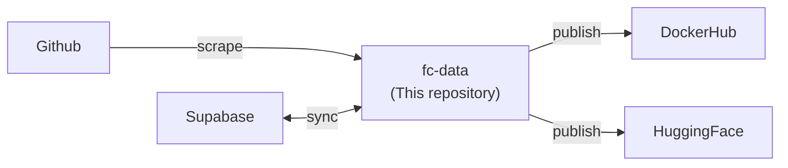

<p align="center">
 <a href="https://formula-code.github.io/">
    
  </a>
  <a href="https://huggingface.co/papers/2603.16011">
    
  </a>
  <a href="https://formula-code.github.io/leaderboard/">
    
  </a>
  <a href="https://formula-code.github.io/datasmith/">
    
  </a>
  <a href="https://data.formulacode.org/">
    
  </a>
</p>

[FormulaCode](https://formula-code.github.io/) is a benchmark, updated each month, that evaluates how well LLM agents optimize codebases. FormulaCode consists of two parts: a [pipeline](https://github.com/formula-code/datasmith) to construct performance optimization tasks, and an [execution harness](https://github.com/formula-code/harbor) (Harbor) that connects a language model to our terminal sandbox. _This repository contains the task generation pipeline._

The end-to-end pipeline, from task selection to RL training, is described in [docs/OVERVIEW.md](docs/OVERVIEW.md).

`fc-data` is a Python package that curates and manages [FormulaCode](https://formula-code.github.io/) tasks. It runs as a monthly CRON job that adds new commits and repositories to the FormulaCode dataset.

## High level overview



## Usage

The monthly update is one command:

```bash
$ fc-data --start-date 2026-02-01 --end-date 2026-03-01
```

This runs nine stages in order: scrape repositories, scrape commits, classify PRs, resolve packages, render problems, synthesize Docker images, run the Harbor oracle health check, publish images to DockerHub and records to HuggingFace, and scrape benchmark source. The dataset is versioned by month (for example `formulacode@2026-03`). The [Pipeline guide](docs/guide/pipeline.md) describes each stage and every flag.

The package is also a library for a custom GitHub-based benchmark: PR models, an async GitHub client, problem statement rendering, cached hooks, concurrent runners, Docker image synthesis and task rendering. The [Quickstart](docs/getting-started/quickstart.md) shows each one with code.

Tasks are Harbor task folders rendered by `datasmith.harbor_adapter`. Render them from a records file with
`fc-render-tasks`, then run them with [Harbor](https://github.com/formula-code/harbor) (Harbor's `adapters/formulacode`
imports this package):
```bash
fc-render-tasks render --records records.jsonl --out tasks/ --cpus 2 --memory 16G --storage 20G
harbor run -p tasks/<owner>__<repo>__<N> -a oracle   # the oracle agent applies the human patch
```

The steps from a rendered task to measurement, review, agent trials and RL training are in [docs/OVERVIEW.md](docs/OVERVIEW.md).

## Installation

See [Installation](docs/getting-started/installation.md) for system dependencies, `tokens.env`, the local Supabase instance and the preflight check. For access from a remote machine, see [Remote access](docs/guide/remote-access.md).

Each new feature must have a test:
```bash
$ make check    # ruff lint + mypy type check
$ make test     # pytest
```
