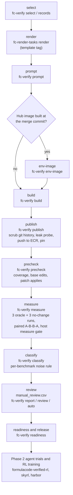

# FormulaCode pipeline overview

This page describes how one FormulaCode task goes from a merged pull request to an approved task that agents and RL
training use. The work spans five repositories. This repository (datasmith) holds the steps up to review and release.

| Repository | What it does in the pipeline |
|---|---|
| [formula-code/datasmith](https://github.com/formula-code/datasmith) | Collects PRs and builds environment images (`fc-data`), renders Harbor task folders (`fc-render-tasks`), and selects, builds, publishes, measures and reviews tasks (`fc-verify`) |
| [formula-code/lsv](https://github.com/formula-code/lsv) | The fork of asv that selects the benchmarks a patch affects and times them |
| [formula-code/snapshot-tester](https://github.com/formula-code/snapshot-tester) | Records benchmark outputs and checks that a patch did not change them |
| [formula-code/harbor](https://github.com/formula-code/harbor) | Runs trials: starts the task container, runs the agent, then runs the task's `tests/test.sh` |
| [formula-code/formulacode-verified-rl](https://github.com/formula-code/formulacode-verified-rl) | Runs the survey (measure, review), keeps the approved list, runs agent trials and the RL recipe |
| [formula-code/skyrl](https://github.com/formula-code/skyrl) | The RL trainer |

## The steps



1. **Select.** `fc-verify records IDS_MD OUT_DIR` writes `records.jsonl` and `ids.md` for chosen `owner/repo#N` PRs from
   the task database. `fc-verify select OUT_DIR --hub TSV` instead draws a ranked sample of database candidates. A
   candidate must be a performance PR with a patch, a base commit, a rendered problem, and an environment image on
   Docker Hub. The selection rules are in `docs/TASK_PIPELINE.md` of formulacode-verified-rl.
2. **Render.** `fc-render-tasks render --records records.jsonl --out TASKS_ROOT` writes one Harbor task folder per record
   from `src/datasmith/harbor_adapter/template/`. Render from a template tag (`template-v1.2`), so every task of a
   release has the same test scripts. Each folder gets `render_stamp.json`; `fc-render-tasks check` finds folders that
   no longer match the installed template.
3. **Prompt.** `fc-verify prompt TASKS_ROOT PROMPTS_DIR` replaces the task description with approved prompt text.
   Nothing else in the task changes. New tasks get short prompts that describe only the symptom
   (`FC_PROMPT_VERSION=short`, the default in stage 5). `fc-verify prompt-draft` writes model drafts for review, and `fc-verify prompt-check`
   checks that a prompt names no benchmarks, changed code, diffs or PR and issue links.
4. **Environment image.** Some Docker Hub images were built at the merge commit, so they already contain the fix.
   `fc-verify env-image owner/repo#N` rebuilds the environment image at the base commit for those tasks.
5. **Build.** `fc-verify build TASKS_ROOT OUT` builds one image per task from its `environment/` folder. The image tag is
   a digest of that folder. Each result is a row in `OUT/manifest.jsonl`; a failure is a row in `OUT/failures.jsonl`.
6. **Publish.** `fc-verify publish TASKS_ROOT MANIFEST OUT` pins the image in `task.toml`, removes the git history after
   the base commit from the image (a new `-scrub` tag), checks that no history exposes the fix, pushes the image to
   ECR, and pins the pushed tag.
7. **Precheck.** `fc-verify precheck SURVEY TASK` runs static checks in the image without network: does the oracle
   patch apply, did the image already contain part of it, and does at least one benchmark run the changed code. A task
   that fails ends in a state such as `uncovered`, `base_edited` or `patch_failed` and is not timed.
8. **Measure.** `fc-verify measure SURVEY TASK` runs one Harbor job per task: 3 oracle runs and 3 no-change runs. Each
   run times the base and the patched code in one container in the order A-B-B-A. The host measure gate
   (`datasmith.verify.services.measure_gate`) limits how many timings run at once, because timing is sensitive to
   memory bandwidth. The result is `SURVEY/oracle/<task>.json`.
9. **Classify.** `fc-verify classify SURVEY` applies the noise rule in `SURVEY/threshold_rule.json`. All values are
   natural-log speedups. For each benchmark $b$, the no-change runs give a spread $\sigma_b$ (pooled with the repo's
   spread), and the threshold is $\theta_b = \mathrm{clip}(k\sigma_b, \theta_{\min}, \theta_{\max})$ with $k = 2$. A
   benchmark is **up** when at least 2 of the 3 oracle runs are above $+\theta_b$, and **down** when at least 2 are
   below $-\theta_b$. The code is in `src/datasmith/verify/noise.py`.
10. **Review.** `fc-verify report SURVEY` prints the per-benchmark table of each measured task that waits for review.
    The user decides with `fc-verify review SURVEY TASK approved|not_approved`. Decisions are in
    `SURVEY/manual_review.csv`. `fc-verify auto SURVEY` applies the automatic rules: a measured task with no benchmark
    up, or a task in an end state without a usable measurement, becomes `not_approved`.
11. **Readiness and release.** `fc-verify readiness SURVEY OUT_CSV` writes one row of facts per reviewed task: pinned
    image, registry status, render commit, runs, CPU models, license and PR author. It gives no verdict.
12. **Agent trials and RL training.** formulacode-verified-rl runs agents on the approved tasks (Phase 2) and trains
    with skyrl. Trials run on Harbor with the same task folders and images.

## What "approved" means

A task is **approved** when it was measured and the user approved it after reading its per-benchmark table. Only the
user approves. The automatic rules only mark tasks `not_approved`, and they never change a row that has a decision.

The approved list is `verified_survey/approved.csv` in formulacode-verified-rl. Each row gives the task, its pinned
image, the render and template commits, the CPU models of the runs, the license and the PR author.

## Rebuild one task

```bash
echo "- owner/repo#N" > ids.md
fc-verify records ids.md sel/                                # records.jsonl from the task database
git -C datasmith checkout template-v1.2                       # render with the release template
fc-render-tasks render --records sel/records.jsonl --out tasks/ --cpus 2 --memory 16G --storage 20G
fc-verify prompt tasks/ prompts/ owner__repo__N               # only when the task has an approved prompt
fc-verify env-image owner/repo#N --registry "${ECR_URI}"      # only when the Hub image is at the merge commit
fc-verify build tasks/ build/ --ids ids.md
fc-verify publish tasks/ build/manifest.jsonl build/
fc-verify add "${SURVEY}" owner__repo__N
fc-verify precheck "${SURVEY}" owner__repo__N                # reads the image tag from state/<task>.json
fc-verify measure "${SURVEY}" owner__repo__N --manifest build/manifest.jsonl --gate "${GATE_URL}"
fc-verify report "${SURVEY}" owner__repo__N
```

The survey pipeline in formulacode-verified-rl (`verified_survey/pipeline.py`, see `verified_survey/README.md`) runs
the precheck and measure steps for many tasks at once and writes the state files.

## Branches and pins

| Repository | Branch or commit | Where it is set |
|---|---|---|
| datasmith | `main`; release template on `release/template-v1` (tags `template-v1`, `template-v1.1`, `template-v1.2`) | the tag you render from |
| lsv | `main` at `9702a48` | `LSV_REF` in `harbor_adapter/template/environment/Dockerfile` and `docker/templates/docker_build_final.sh` |
| snapshot-tester | `f08bb0c` | `SNAPSHOT_TESTER_REF` in the same two files |
| harbor | `formulacode/harbor-reliability` | the harbor checkout that runs trials |
| skyrl | `main` | the trainer checkout |
| formulacode-verified-rl | `main` | the survey and recipe checkout |
