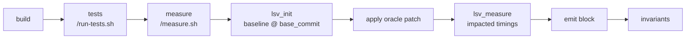

# Verification

Verification checks that each task's Docker image builds, passes its tests and can measure a speedup.

## Measurability

After the test stage passes, stage 6 (`local_ci.py`) runs the image again with
`/measure.sh`. This shows that the container can **measure a speedup**.



The oracle patch is bind-mounted read-only from `task/solution.patch` and is
not stored in the image, because the agent under evaluation could read it there.
The benchmark directory and `asv.*.json` sections are removed from the patch
before it is applied, as `run-tests.sh` resets them at trial time. The measured
benchmarks are then the ones that exist at both commits.

Three fatal invariants stop the step:

| Invariant | Fires when |
|-----------|-----------|
| `measure_timed_out` | measurement exceeded its limit; a timeout is a **failure** |
| `asv_exec_failed` | no benchmark produced a finite, non-zero timing at both commits |
| `oracle_patch_failed` | the stored patch exists but did not apply |

Three more are warnings and do not stop the step: `speedup_direction`
(geomean below 1.0), `oracle_patch_touches_benchmarks` (the PR modified its own
benchmarks, so the measured set is narrower than the patch), and
`measure_partial` (LSV reported an error but still produced usable timings).

A failure here writes `failure.json` with `"stage": "measure"`.

**Cost.** The measure step adds minutes to each task. It runs only after the
build and test stages pass, so a failed attempt does not pay for it.

### Settings

| Variable | Default | Effect |
|----------|---------|--------|
| `DATASMITH_VERIFY_MEASURE_TIMEOUT_S` | `3600` | Wall-clock limit for the measure step |
| `DATASMITH_VERIFY_MEASURE_ROUNDS` | `2` | LSV timing rounds; the same default as `--harbor-rounds` in stage 7 |
| `DATASMITH_VERIFY_MEASURE_GEOMEAN_MIN` | `1.0` | Threshold for the `speedup_direction` warning |

## Correctness tests in harbor tasks

A harbor task's `tests/test.sh` runs `tests/pytest_runner.py`, which selects tests from the files the patch changes. Tests or snapshots must check correctness, and a trial where neither ran is graded `unverified`.

- Tests that map from the changed files by name run first.
- When none map and the patch changes Python sources, the runner runs the nearest tests folder above them (`strategy: regression-fallback:package-tests`).
- When none map and the patch changes compiled sources (C, C++, Cython, Fortran, CUDA, their `.in`, `.src` or `.tp` templates, or build files), the runner runs up to 12 test files from the nearest tests folder above them, best name matches first (`strategy: compiled_fallback`). `test.sh` rebuilds the extensions for the same file types first.
- The runner then stashes the patch, rebuilds, and runs the same tests at the base commit. A test that passes at base and fails with the patch is a regression.
- Oracle runs and agent attempts use the same selection.

## Order in test.sh and when the timing is skipped

`test.sh` runs snapshots and pytest first, then the LSV timing. It skips the timing (`lsv_skipped.json`) in these cases:

| Reason | When | Graded as |
|---|---|---|
| `no_patch` | The patch changes no files | `no_patch` |
| `pytest_regression` | A test passes at base and fails with the patch, and is not in `FC_ORACLE_FAILING_TESTS` | `pytest_regression` |
| `snapshots_regressed` | A snapshot passes or skips at base and fails with the patch; libraries in `FORMULACODE_SNAPSHOT_SKIP_LIBS` (default `dask`) are exempt | `snapshots_regressed` |
| `tree_not_restored` | After pytest's base run, the tree differs from the agent's (an edit left stashed is popped first) | failure |
| `base_changed` | The base copy `/workspace/.fc_base` differs from its digest at the end of setup (`FC_BASE_DIGEST` from the host, else `/opt/fc_base_digest`) | failure |

The first three follow the host's grading rules in `fcrl.grading`, so the reward is the same as with timing. They do not apply to the oracle, to replays with `FC_SKIP_PYTEST` or `FC_SKIP_SNAPSHOT`, or with `FC_TIMING_SHORT_CIRCUIT=0`, which noise studies use to time every patch.

## Preflight check

Run `python -m datasmith.preflight` before verification. [Installation](../getting-started/installation.md#5-verify-your-setup)
lists its checks. It also prints report lines that cannot fail the run: the GitHub token pool size and its hourly
request budget, the median database round-trip latency, and the resolved concurrency settings for stages 2 to 5.
These values differ between machines and have no single correct threshold.

## Reading a manifest programmatically

Read the build manifest of a built image and evaluate the invariants:

```python
from datasmith.docker import read_build_manifest, evaluate_invariants

manifest = read_build_manifest("formulacode/pandas-dev-pandas:16222")
report = evaluate_invariants(manifest)

report.ok        # True (all fatals held) / False (a fatal failed) / None (no manifest)
report.fatal     # ["asv_exec_failed", "oracle_patch_failed"]
report.warnings  # ["speedup_direction", "discovery_fallback_used"]
report.skipped   # invariants whose inputs were absent
```

`ok` has three values. For an image without a manifest, `read_build_manifest`
returns `None`, and `evaluate_invariants(None)` reports `ok=None` with every
invariant skipped. It does not report a pass for checks it did not run.

This reads what the build recorded, so it runs offline and needs no rebuild.
