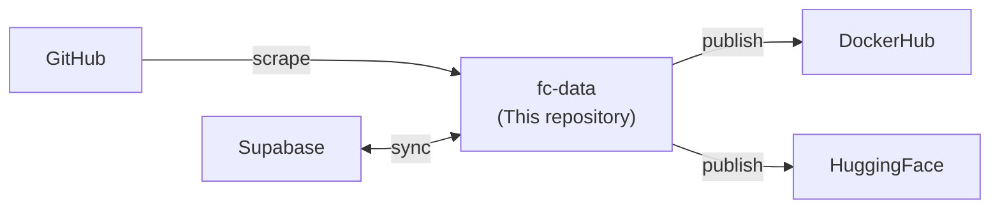

<p align="center">
  <a href="https://formula-code.github.io/">
    
  </a>
  <a href="https://huggingface.co/papers/2603.16011">
    
  </a>
  <a href="https://formula-code.github.io/leaderboard/">
    
  </a>
  <a href="https://formula-code.github.io/datasmith/">
    
  </a>
  <a href="https://data.formulacode.org/">
    
  </a>
</p>

`fc-data` is a Python package that curates and manages [FormulaCode](https://formula-code.github.io/) tasks. It runs as a monthly CRON job that adds new commits and repositories to the FormulaCode dataset.

[FormulaCode](https://formula-code.github.io/) is a benchmark, updated each month, that evaluates how well LLM agents optimize codebases. FormulaCode consists of two parts: a [pipeline](https://github.com/formula-code/datasmith) to construct performance optimization tasks, and an [execution harness](https://github.com/formula-code/harbor) (Harbor) that connects a language model to our terminal sandbox.


## How it works



## Get started

The monthly update is one command:

```bash
fc-data --start-date 2026-03-01 --end-date 2026-04-01
```

This runs all 9 pipeline stages: repo discovery, PR scraping, LLM classification, dependency resolution, problem rendering, Docker synthesis, the Harbor oracle health check, publishing and benchmark source scraping. See the **[Pipeline guide](guide/pipeline.md)** for the full CLI reference.

## Key features

- **Single-command pipeline** — `fc-data` runs all stages with `--resume`, `--stage`, and `--dry-run` support
- **GitHub scraping** — Async `httpx` client with automatic token rotation across multiple `GH_TOKENS`
- **LLM classification** — DSPy-based agents classify PRs by performance category and difficulty
- **Docker synthesis** — Generate Docker build contexts with coding agents (Claude Code, Codex, Gemini, Qwen Code)
- **Concurrent runners** — Async runners with concurrency limits, Supabase progress tracking and per-item error logging
- **Dataset publishing** — Versioned Parquet datasets on HuggingFace, Docker images on DockerHub

## Quick links

- [Installation](getting-started/installation.md) — Set up your development environment
- [Pipeline guide (`fc-data`)](guide/pipeline.md) — CLI reference and stage descriptions
- [Quickstart](getting-started/quickstart.md) — Python API examples
- [Configuration](guide/configuration.md) — `tokens.env` and environment variables
- [Overview](OVERVIEW.md) — From a merged PR to an approved, measured task
